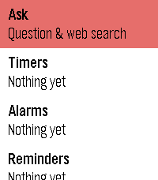
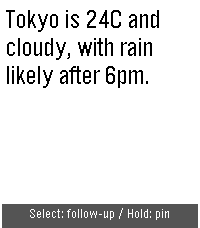
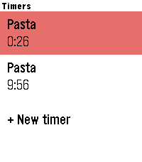
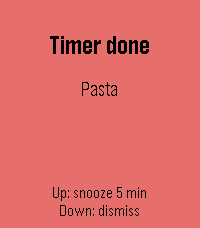
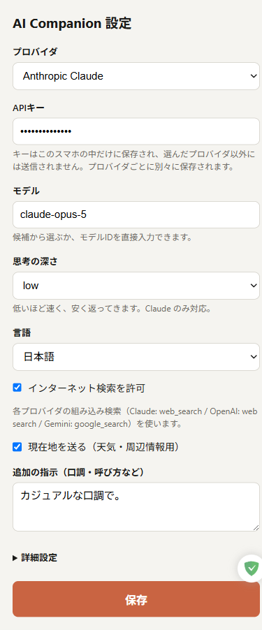

# AI Companion for Pebble

Pebble 上で動く AI コンパニオン。話しかけるとインターネット検索をして答え、
タイマー・アラーム・リマインダーをその場でセットし、残しておきたいことは
Pebble タイムラインにピン止めします。

対象プラットフォームは **emery（Pebble Time 2 / 200x228）** と **gabbro（Pebble Round 2 / 260x260 丸型）**。
両機種ともタッチ操作に対応し、スピーカーのある Time 2 ではアラームと回答の到着を音でも知らせます。
腕時計側（C）が UI とスケジュールを持ち、スマホ側（PebbleKit JS）が LLM の
API を呼んでツールを実行します。

**Anthropic Claude / OpenAI / Google Gemini** に対応。設定画面で選ぶだけで、
検索も含めてそのプロバイダの組み込み機能に切り替わります。

| | | | |
|---|---|---|---|
|  |  |  |  |

（スクリーンショットは英語表示。日本語表示には言語パックが必要です → [制限と注意](#制限と注意)）

---

## 機能

### ご依頼のあった機能

| 機能 | 実装 |
|------|------|
| インターネット検索 | 各プロバイダの組み込み検索（下表）。天気・ニュース・営業時間などは自動で検索してから答えます |
| タイマー | 腕時計の Wakeup API。アプリを閉じても、スマホが圏外でも鳴ります |
| アラーム | 同上。時刻指定。手動追加は時→分の 2 ステップ |
| リマインダー | 腕時計のアラート＋タイムラインピンの両方。AI が日時を解釈して登録します |
| ピン止め | 回答画面で SELECT 長押し。AI から `pin_note` ツール経由でも作成できます |

### あわせてピックアップした機能

- **音声入力（Dictation）** — メニューから即座に録音開始。マイク非搭載・失敗時は定型文メニューにフォールバック
- **長期記憶** — `remember_fact` ツール。好み・呼び方・習慣を覚えて次回以降のプロンプトに自動で載せます
- **今日のまとめ** — 天気・予定・ニュースを 3 文で。1 タップで実行
- **AppGlance 連携** — 次に鳴る予定を時計盤のアプリ一覧に表示
- **クイックランチ** — ボタン長押しでアプリを起動すると、いきなり音声入力が始まります
- **位置情報の自動付与** — 「近くの」「今日の天気」を現在地で解釈（設定でオフ可）
- **会話の継続** — 10 分以内の追加質問は文脈を引き継ぎます
- **日英切り替え** — 腕時計 UI と回答の言語を設定画面から変更
- **スケジュール認識** — 腕時計に入っている予定を AI に同期。「今日の予定は?」「全部消して」に答えられます
- **Google カレンダー連携** — 「明日の予定は?」に答えます。ライト（読むだけ、アドレスを貼るだけ）と上級者向け（「金曜15時に歯医者を入れて」「16時にずらして」「消して」まで。変更と削除は腕時計で確認してから）の2段階。手順は [docs/CALENDAR.md](docs/CALENDAR.md)
- **プロバイダ切り替え** — Claude / OpenAI / Gemini。APIキー・モデル・エンドポイントはプロバイダごとに保存されるので、行き来しても入れ直しは不要です

---

## 対応プロバイダ

| | 既定モデル | エンドポイント | 検索 | 会話の保持 |
|---|---|---|---|---|
| **Anthropic Claude** | `claude-sonnet-5` | `POST /v1/messages` | サーバーサイド `web_search` ツール | 履歴をスマホ側で保持して毎回送信 |
| **OpenAI** | `gpt-5.6-terra` | `POST /v1/responses` | 組み込み `web_search` ツール | `input` 配列をスマホ側で積み上げ |
| **Google Gemini** | `gemini-flash-latest` | `POST /v1beta/interactions` | `google_search` グラウンディング | `previous_interaction_id` でサーバー側に保持 |

既定は各社の**ミドル級**です。腕時計の回答は2文なので、フラッグシップは待ち時間と
コストが増えるだけで見た目が変わりません。Gemini はローリングエイリアスがあるので
それを使い、アプリを更新しなくても最新版に追従します。フラッグシップ
（`claude-opus-5` / `gpt-6-astra` / `gemini-pro-latest`）は設定画面の候補から選べます。

### 思考の深さ

**3社とも対応しています。** フィールド名だけが違うので、設定の `low` / `medium` /
`high` を各社の形に変換して送っています。

| | フィールド | 指定できる値 |
|---|---|---|
| **Anthropic Claude** | `output_config.effort` | low / medium / high / xhigh / max |
| **OpenAI** | `reasoning.effort` | none / minimal / low / medium / high / xhigh / max |
| **Google Gemini** | `generation_config.thinking_level` | minimal / low / medium / high |

設定画面が `low` / `medium` / `high` の3段階なのは、これが3社の共通部分だからです。
既定は `low`。腕時計で待たされないことを優先しています。

ツール（タイマー・ピン止め等）の定義と実行は `tools.js` で共通です。各プロバイダの
差分は `src/pkjs/providers/` の中だけに閉じています。

**プロバイダを切り替えると、APIキー・モデル・エンドポイントも一緒に切り替わります。**
3つとも別枠で保存されるので、行き来しても入れ直しは不要です。

モデルとエンドポイントは**値ではなく上書き**として扱います。設定画面の入力欄は
空で、既定値はプレースホルダに薄く表示されるだけです。空のまま保存すれば storage
には何も書かれず、常に `providers/catalog.js` の既定値が使われます。入力したときだけ
上書きとして保存されます。既定値を入力欄に埋めてしまうと、それが「ユーザーが入れた値」
として固定化され、プロバイダを変えても追従しなくなるためです。

---

## セットアップ

### 1. ビルド

```bash
pebble build
pebble install --emulator emery       # Round 2 は --emulator gabbro。実機は --phone <IP>
```

### 2. プロバイダと API キーを入れる

スマホの Pebble アプリ → アプリ一覧 → **AI Companion** → 歯車アイコン。
設定画面はアプリ内に埋め込まれた `data:` URL なので、ホスティングは不要です。



| 項目 | 既定値 | 備考 |
|------|--------|------|
| プロバイダ | Anthropic Claude | OpenAI / Google Gemini に切り替え可 |
| API キー | （空） | **このスマホの localStorage にのみ保存され、選んだプロバイダにだけ送られます**。プロバイダごとに別枠 |
| モデル | プロバイダの既定（ミドル級） | 空欄なら既定値。上書きしたいときだけ入力 |
| 思考の深さ | `low` | 3社とも対応。時計の待ち時間を短くするため既定は low |
| 言語 | スマホの言語（日本語なら日本語、それ以外は英語） | 腕時計 UI と回答の言語。腕時計側も、スマホから設定が届くまでは腕時計の言語設定に合わせます |
| インターネット検索 | ON | 選んだプロバイダの組み込み検索を使います |
| 現在地を AI に送る | **OFF** | オンにすると、質問のたびにおおよその現在地を選んだプロバイダに送ります（天気・周辺情報用） |
| 音を鳴らす | ON | アラーム等のメロディと回答のチャイム。スピーカーのある Time 2 のみ。オフでも振動はします。腕時計側にも保存されるので、スマホが離れていても反映されます |
| API エンドポイント | プロバイダの既定 | 互換ゲートウェイ経由のときだけ変更 |
| Google カレンダー連携 | オフ | ライト（iCal の非公開アドレス、読むだけ）か上級者向け（Apps Script、読み書き）。[設定手順](docs/CALENDAR.md) |

エミュレータで設定画面を開く場合:

```bash
pebble emu-app-config
```

### 3. スマホ側のロジックを検証する

実 API を叩かずに、3 プロバイダのツールループを Node 上で流せます。

```bash
node devtest.js
```

`localStorage` / `XMLHttpRequest` / `Pebble` をスタブし、各プロバイダのリクエスト
形状・ツール往復・回答の分割送信を実際のバンドルに対して検証します。

実際のプロバイダに繋いで確かめたいときは:

```bash
PROVIDER=gemini API_KEY=... node livetest.js
PROVIDER=gemini API_KEY=... node livetest.js '10分のタイマー' '予定を教えて'
PROVIDER=gemini MODEL=gemini-pro-latest API_KEY=... node livetest.js
PROVIDER=gemini API_KEY=... node livetest.js --verbose      # 生の HTTP を表示
```

引数で任意の質問を並べられます。キーは環境変数からのみ読み、ファイルには書きません。
課金が発生します。

### 4. Google カレンダー連携（任意）

つなぎ方は2通りです。設定画面の「Google カレンダー連携 → 連携方法」で選びます。

| | ライト | 上級者向け |
|---|---|---|
| 仕組み | カレンダーの「iCal 形式の非公開アドレス」をスマホが直接読む | 自分の Google アカウントに置いた Apps Script（[`gas/Code.gs`](gas/Code.gs)）を呼ぶ |
| できること | 予定を読む | 読む・追加・変更・削除（変更と削除は腕時計で確認してから） |
| 準備 | アドレスを1つコピー | スクリプトのデプロイ（5分） |

手順は **[docs/CALENDAR.md](docs/CALENDAR.md)** にあります（設定画面からもリンクしています）。

Google のデバイス向け OAuth はカレンダーの権限に対応しておらず、PebbleKit JS には
通常のログインを通すブラウザもないため、この2方式にしています。どちらも開発者の
サーバーは経由しません。

---|---|
| 取得 | 表示中（Google カレンダーでチェックが入っている）のカレンダーすべてから |
| 追加 | 既定のカレンダーに。時刻指定は1時間、日付だけなら終日の予定 |
| 変更 | 名前・時刻・場所。**腕時計で確認してから**実行 |
| 削除 | **腕時計で確認してから**実行。繰り返しの予定はその回だけ |

変更・削除は自分が所有するカレンダーの予定に限ります（祝日カレンダーなどは読むだけ）。
確認画面は 60 秒答えないと「やめる」扱いになります。

**注意**

- URL と `SECRET` の両方を知っている人は、あなたのカレンダーを読み書きできます。
  `SECRET` は短くしないでください。漏れたらスクリプト プロパティの値を変え、
  設定画面にも新しい値を入れ直してください（再デプロイは不要です）。
- `gas/Code.gs` を更新したら「デプロイ」→「デプロイを管理」→ 編集 →
  バージョン「新バージョン」で更新すると、URL を変えずに反映できます。

---

## 操作

```
メインメニュー
├ 話しかける      → 音声入力 → 回答画面
├ タイマー        → 一覧 / ＋追加（分を選ぶ）
├ アラーム        → 一覧 / ＋追加（時→分）
├ リマインダー    → 一覧 / ＋AIに頼む
├ 今日のまとめ    → 天気・予定・ニュース
└ 情報
```

**回答画面**

| 操作 | 動作 |
|------|------|
| 上 / 下 | スクロール |
| 選択 | 追加質問（音声入力） |
| 選択（長押し） | いまの回答をタイムラインにピン止め |
| 戻る | メニューへ |

**一覧画面** — 項目を選ぶと削除。いちばん下の行が追加。

**アラート画面**（鳴ったとき） — 上=5 分後に再通知 / 下・選択=停止。

**確認画面**（AI がカレンダーの予定を変更・削除しようとしたとき） — 上=実行 / 下・戻る=やめる。

**タッチ操作**（Time 2 / Round 2） — メニューと回答画面はスワイプでスクロール、タップで選択。
アラート画面と確認画面は上スワイプ=上ボタン、下スワイプ=下ボタン（タップには何も割り当てていません）。

---

## 構成

```
src/c/
  main.c        起動・Wakeup・ライフサイクル
  comm.c/.h     AppMessage。コマンド定義とスマホからの指示の適用
  store.c/.h    予定の永続化、Wakeup の再スケジュール、AppGlance
  i18n.c/.h     日英の文字列テーブル
  win_main.c    メインメニューと情報画面
  win_ask.c     音声入力・回答表示・定型文メニュー
  win_list.c    タイマー/アラーム/リマインダー一覧と追加フロー
  win_alert.c   発火時のアラート画面
  win_confirm.c AI の破壊的な操作（カレンダーの変更・削除）の前に出す確認画面
  sound.c/.h    スピーカーの効果音（スピーカーのない機種では何もしない）

src/pkjs/
  index.js         イベント処理、送信キュー、チャンク分割
  provider.js      有効なプロバイダへの振り分け
  providers/
    catalog.js     プロバイダのメタデータ（依存なし。設定と設定画面が参照）
    anthropic.js   Messages API とツールループ
    openai.js      Responses API とツールループ
    gemini.js      Interactions API とツールループ
  prompt.js        システムプロンプトの組み立て（プロバイダ共通）
  http.js          XHR ラッパとエラー整形
  tools.js         ツール定義とローカル実行（プロバイダ共通）
  timeline.js      タイムラインピンの作成
  calendar.js      Google カレンダー（ライト / 上級者向け）の窓口と予定 ID の対応表
  ical.js          iCal（.ics）の解析と繰り返し予定の展開（ライト用）
  settings.js      設定と長期記憶
  config_page.js   設定画面（data: URL として埋め込み）

gas/Code.gs        Google カレンダー中継用の Apps Script（上級者向け。ユーザーが自分でデプロイ）
docs/CALENDAR.md   カレンダー連携の設定手順（英語・日本語）
PRIVACY.md         プライバシーポリシー（英語・日本語）
store/             アプリストア用の説明文・アイコン・スクリーンショット

devtest.js         スマホ側ロジックの Node 検証ハーネス（スタブ、無課金）
livetest.js        実プロバイダに繋ぐスモークテスト（課金あり）
```

### 通信の流れ

```
腕時計                     スマホ (PebbleKit JS)         LLM プロバイダ
  │  REQ_CMD=ASK ─────────────▶│
  │                            │  POST（プロバイダ別）─────────▶│
  │  ◀── RES_STATUS=THINKING   │                               │
  │                            │  ◀── ツール呼び出し / 検索 ────│
  │  ◀── RES_STATUS=SEARCHING  │                               │
  │  ◀── ACT_KIND=TIMER        │  （タイマー等は腕時計に反映）  │
  │                            │  ツール結果 ─────────────────▶│
  │  ◀── RES_TEXT (分割) ×N    │  ◀── 最終回答 ────────────────│
```

タイマー・アラーム・リマインダーの実体は**腕時計側**にあります。スマホが
圏外でもバッテリー切れでも鳴るのはこのためです。スマホ側は予定の写しを
持っていて、AI が「今日の予定は?」に答えるときに使います。

写しは2方向から更新されます。腕時計は予定が変わるたびに `CMD_SYNC` を送り返し、
スマホ側もツールを実行した時点で写しをその場で更新します。後者がないと、
「タイマーをセットして、あと何分か教えて」のように**同じターンの中で**予定を
変えて読み直すとき、Bluetooth の往復が間に合わず古い写しを読んでしまいます。

---

## 困ったとき

### 認証エラーが出る

時計に出るエラーには**プロバイダ名が付きます**。まずそこを見てください。

```
Anthropic Claude: x-api-key header is required
```

これは「Anthropic のエンドポイントに、キーヘッダ無しで飛んだ」という意味です。
`x-api-key` は Anthropic、`API key not valid` は Google、
`You didn't provide an API key` は OpenAI の文言なので、**どのプロバイダが実際に
動いたか**が一目で分かります。意図と違うプロバイダ名が出ていたら、設定が保存
されていません（保存ボタンを押したか、設定画面が `pebblejs://close` で閉じたかを確認）。

**エンドポイントが別のプロバイダのものになっていた場合**は、起動時に自動で
修復します（`settings.repair()`）。「あるプロバイダの保存値が、別のプロバイダの
既定値と一致している」なら、それは誰も入力していない値なので破棄して既定値に
戻します。ログに `dropping base_url_gemini: it is anthropic's default` と出ます。
手動で直したいときは、詳細設定のエンドポイント欄を**空にして保存**してください。

意図どおりのプロバイダ名なのにキーが無いと言われる場合は、**キーに紛れ込んだ
空白・改行**が原因のことがあります。ヘッダ値に改行が入ると、エンジンによっては
ヘッダごと落とされて「キーが送られていない」と判定されます。保存時・読み出し時
とも前後の空白を落とすようにしてありますが、古い保存値が残っている場合は
設定画面でキーを入れ直してください。

### スマホ側のログを見る

PebbleKit JS の `console.log` は `pebble logs` に出ます。

```bash
pebble logs --phone <IP>
```

リクエストのたびに、こう出ます。

```
provider=gemini model=gemini-3.8-flash endpoint=https://... keyLength=53
POST https://... [x-goog-api-key, Api-Revision]
```

`keyLength=0` ならキーが保存されていません。角括弧の中に認証ヘッダが
無ければ、値が空か、設定に失敗しています。

---

## 制限と注意

- **日本語表示には言語パックが必要です。** Pebble のシステムフォントは日本語の
  グリフを持たないため、言語パック未導入の時計では豆腐になります。
  `~/Pebble-font/pebble-japanese-custom-font` の言語パックを入れるか、設定で
  English を選んでください。エミュレータには言語パックがないので英語推奨です。
  切り替えは設定画面の「言語」だけで、腕時計 UI と AI の回答の両方に効きます。
- **API キーはスマホに平文で保存され、スマホから直接プロバイダに送られます。**
  中継サーバーを置いていないので、キーの管理はご自身の責任になります。
- **モデル ID は変わります。** Anthropic と OpenAI にはローリングエイリアスが無いので、
  候補は `providers/catalog.js` を書いた時点のものです。エラーになったら設定画面の
  「モデル」に正しい ID を直接入力するか、catalog を更新してください。
- **Gemini は会話をサーバー側に置きます**（`previous_interaction_id`）。10 分以上空くと
  スマホ側がチェーンを切るので、そこから先は新しい会話になります。
- **Wakeup は 1 アプリ 8 件まで**、かつ 1 分以内に 2 件は登録できません。
  9 件目以降は一覧には残りますが鳴りません。近い順に 8 件が登録されます。
- **ピン止めには新しい Pebble スマホアプリが必要です**（local pin を使います）。
  タイムラインの Web API には対応していないので、古いアプリではピン止めできません。
- 回答は腕時計側のバッファに合わせて約 960 バイトで打ち切られます。
- 予定は最大 12 件、ラベルは 39 バイトまでです。

---

## プライバシー

開発者はサーバーを運用しておらず、何も収集しません。質問などは、あなたの API キーで
選んだ AI プロバイダに直接送られます。現在地は設定でオンにしたときだけ送ります。
詳しくは [PRIVACY.md](PRIVACY.md)。

---

## ライセンス

MIT
